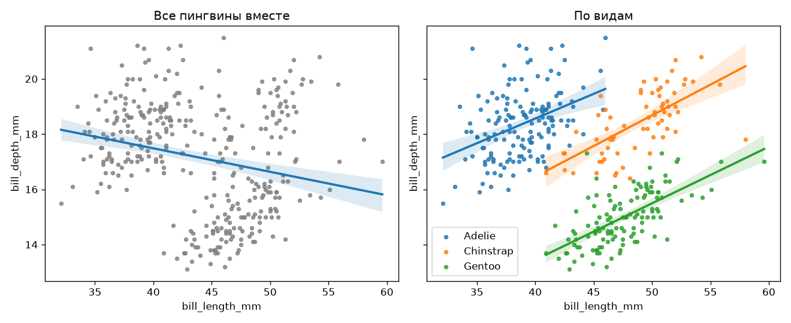
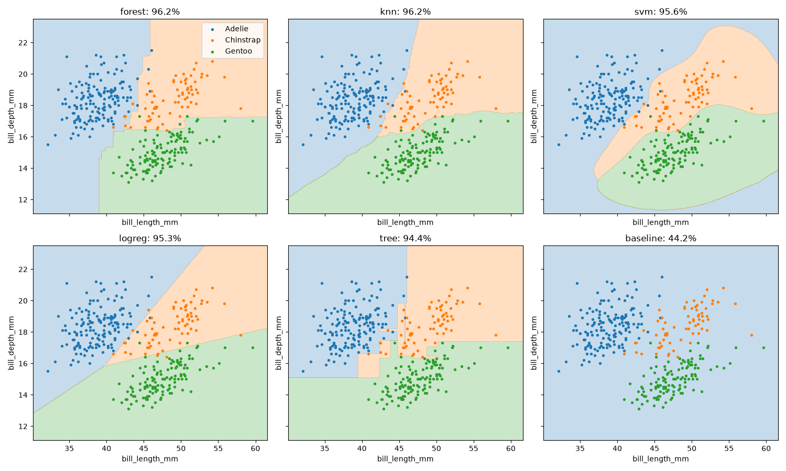
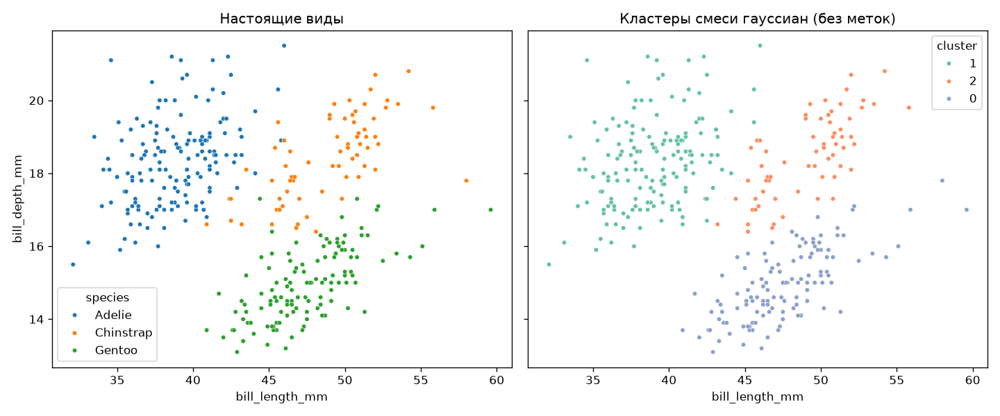

# Пингвины Палмера

[](https://github.com/purringcoal/palmer_penguins/actions/workflows/tests.yml)
[](https://github.com/astral-sh/ruff)

Исследование морфологии трёх видов пингвинов архипелага Палмер. Парадокс Симпсона в размерах клюва, половой диморфизм, определение вида по размерам клюва с честной оценкой качества и проверка выводов методами без асимптотических допущений. Весь путь от сырых данных до чисел в этом README воспроизводится одной последовательностью команд и автоматически проверяется в CI.

## Коротко
- Главная находка: по всем птицам длина и глубина клюва связаны отрицательно ($r \approx -0.24$), а внутри каждого вида - положительно ($r$ от $0.39$ до $0.65$). Это парадокс Симпсона.
- Классификация: вид определяется по двум размерам клюва с точностью 94–96 % (вложенная кросс-валидация) против 44 % у константного предсказания.
- Воспроизводимость: версии пакетов зафиксированы conda-lock, исходные данные - ссылкой на коммит источника и SHA-256; 24 теста; CI на GitHub Actions выполняет тесты, конвейер данных и все блокноты, ruff и pre-commit.
- Стек: Python 3.12, pandas, NumPy, SciPy, scikit-learn, matplotlib, seaborn, pytest, Jupyter.

## Вопросы
1. Как связаны длина и глубина клюва?
2. Различается ли масса самцов и самок у вида Adelie?
3. Можно ли определить вид пингвина только по размерам клюва?

## Данные
Horst, Hill, Gorman (2020), пакет palmerpenguins.

Источник зафиксирован: файл скачивается по ссылке на конкретный коммит
репозитория palmerpenguins (`156daa4`), а при каждом запуске конвейера
сверяется его SHA-256 (`f204db2c…`). Любое расхождение останавливает конвейер.

## Результаты
1. **Парадокс Симпсона.** По всем птицам длина и глубина клюва связаны отрицательно (r ≈ −0.24),
   но внутри каждого вида — положительно (r от 0.39 до 0.65). Причина — различия между видами.
   
2. **Половой диморфизм Adelie.** Самцы тяжелее самок в среднем на ≈ 675 г
   (95% ДИ: 573–776 г; тест Уэлча, p < 10⁻²⁰).
3. **Определение вида по клюву.** Пять моделей (логистическая регрессия, kNN,
   дерево, случайный лес, SVM) с подбором гиперпараметров оценены вложенной
   кросс-валидацией. Все дают 94–96 % против 44 % у константного предсказания.
   По тесту Макнемара с поправкой Холма различия между моделями незначимы,
   поэтому итоговая модель - самая простая, логистическая регрессия (95,3 %).
   Чаще всего модели ошибаются на Chinstrap. "Наивная" оценка, в которой одна
   кросс-валидация и подбирает гиперпараметры, и оценивает качество, в среднем
   завышена на 0,2–0,9 п. п.
   
4. **Проверка без асимптотики и без меток.**
   - Перестановочный тест и бутстреп подтверждают выводы Уэлча: для массы
     самцов и самок Adelie бутстреп-интервал 577–776 г; масса Chinstrap и Adelie
     не различается (p = 0,6).
   - В линейной регрессии глубины клюва коэффициент при длине меняет знак
     после учёта вида, оба 95 %-интервала не содержат ноль.
     Это формальная версия парадокса Симпсона.
   - Смесь гауссиан без меток находит три группы (минимум BIC при K = 3),
     близкие к видам (ARI = 0,91). Стандартизация признаков помогла EM-алгоритму
     найти лучший локальный максимум правдоподобия.
   

## Как запустить

Нужны [Anaconda](https://www.anaconda.com/download) или Miniforge и git.

    git clone https://github.com/purringcoal/palmer_penguins.git
    cd palmer_penguins

    conda create -n tools -c conda-forge conda-lock      # один раз на компьютер
    conda activate tools
    conda-lock install -n palmer_penguins conda-lock.yml

    conda activate palmer_penguins
    pip install -e .
    pre-commit install                                   # один раз после клонирования

    python -m palmer_penguins.pipeline                   # скачать и очистить данные
    pytest

Затем открыть блокноты из папки `notebooks/` по порядку.

| Блокнот | Содержание |
|---|---|
| `01_exploration.ipynb` | разведочный анализ: пропуски, баланс видов, связь вида и острова |
| `02_analysis.ipynb` | ответы на три вопроса: корреляции, t-критерий Уэлча, логистическая регрессия |
| `03_models.ipynb` | сравнение моделей: вложенная кросс-валидация, тест Макнемара, границы решений |
| `04_statistics.ipynb` | перестановочный тест, бутстреп, регрессия с учётом вида, смесь гауссиан |


## Автоматические проверки

Качество проекта проверяется на трёх уровнях.

| Когда | Чем | Что проверяется |
|---|---|---|
| Перед каждым коммитом | [pre-commit](https://pre-commit.com) | ruff (линтер и форматтер), синтаксис YAML/TOML, пробелы и переводы строк, маркеры конфликтов, файлы больше 1 МБ |
| При каждом push в `main`, на каждый pull request и раз в неделю | [GitHub Actions](.github/workflows/tests.yml) | всё перечисленное ниже, на чистой машине |

Что делает CI:

| Проверка | Инструмент | Что гарантирует |
|---|---|---|
| Окружение | micromamba + `conda-lock.yml` | точные версии всех пакетов, как у автора |
| Стиль и типичные ошибки | [ruff](https://github.com/astral-sh/ruff) | код без замечаний линтера и единообразно отформатирован |
| Юнит-тесты | `pytest` | очистка данных, проверка контрольной суммы, сравнение моделей и статистические функции работают на контрольных примерах, без доступа к сети |
| Конвейер данных | `python -m palmer_penguins.pipeline` | исходный файл скачивается с нуля, его SHA-256 совпадает с зафиксированным, после очистки ровно 342 строки |
| Блокноты | `jupyter nbconvert --execute` | все блокноты выполняются сверху вниз в свежем ядре |

Еженедельный запуск нужен, чтобы вовремя заметить недоступность внешнего источника данных.

### Проверить локально

    conda activate palmer_penguins
    pre-commit run --all-files    # все хуки по всему проекту
    pytest
    python -m palmer_penguins.pipeline

Настройки ruff находятся в `pyproject.toml` (раздел `[tool.ruff]`), хуки — в `.pre-commit-config.yaml`.

## Как вносить изменения

1. Сделать правку и закоммитить как обычно. Хуки pre-commit запустятся сами.
2. Если хук исправил файлы («files were modified by this hook»), посмотреть изменения,
   снова выполнить `git add` для этих файлов и повторить `git commit`.
3. Если хук нашёл ошибку без автоисправления, поправить её вручную и повторить.
4. После `git push` дождаться зелёной проверки CI на вкладке Actions.

Зависимости меняются только через `environment.yml` с последующей перегенерацией
`conda-lock.yml`; оба файла коммитятся вместе. Версия `rev` у `ruff-pre-commit`
в `.pre-commit-config.yaml` должна совпадать с версией ruff в lock-файле.

## Структура проекта

```
palmer_penguins/
├── .github/workflows/tests.yml   CI
├── .pre-commit-config.yaml       хуки перед коммитом
├── .vscode/settings.json         ruff в VS Code
├── environment.yml               требования к окружению
├── conda-lock.yml                точные версии пакетов
├── pyproject.toml                пакет и настройки ruff
├── data/                         не в git: создаётся конвейером
│   ├── raw/                      исходный файл, никогда не редактируется
│   └── processed/                очищенные данные
├── notebooks/                    01–04, по порядку
├── reports/figures/              графики для README
├── src/palmer_penguins/
│   ├── data.py                   загрузка, контрольная сумма, очистка
│   ├── pipeline.py               конвейер: сырые данные → очищенные
│   ├── models.py                 кандидаты, вложенная кросс-валидация, тест Макнемара
│   └── inference.py              перестановки, бутстреп, метод наименьших квадратов
└── tests/                        тесты pytest
```
